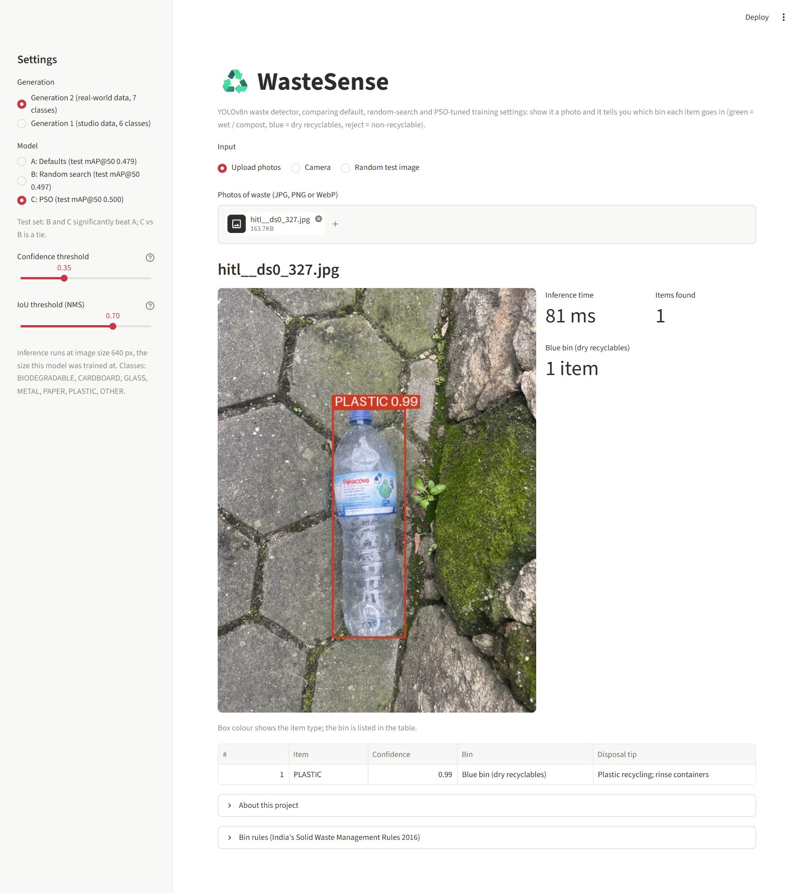
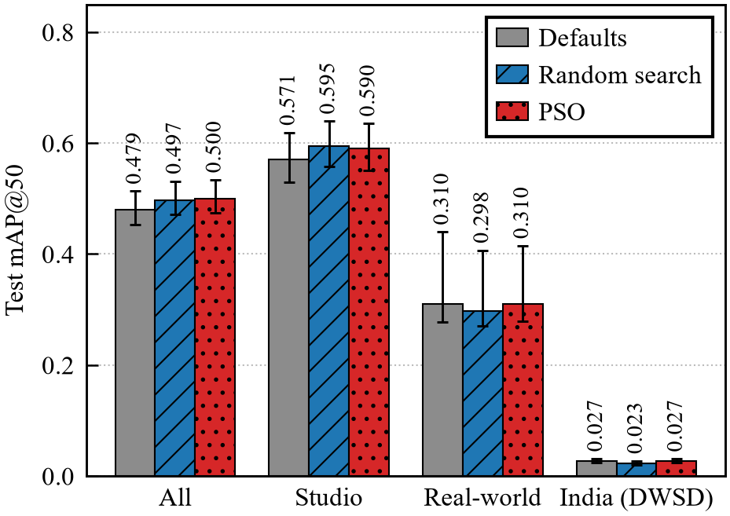
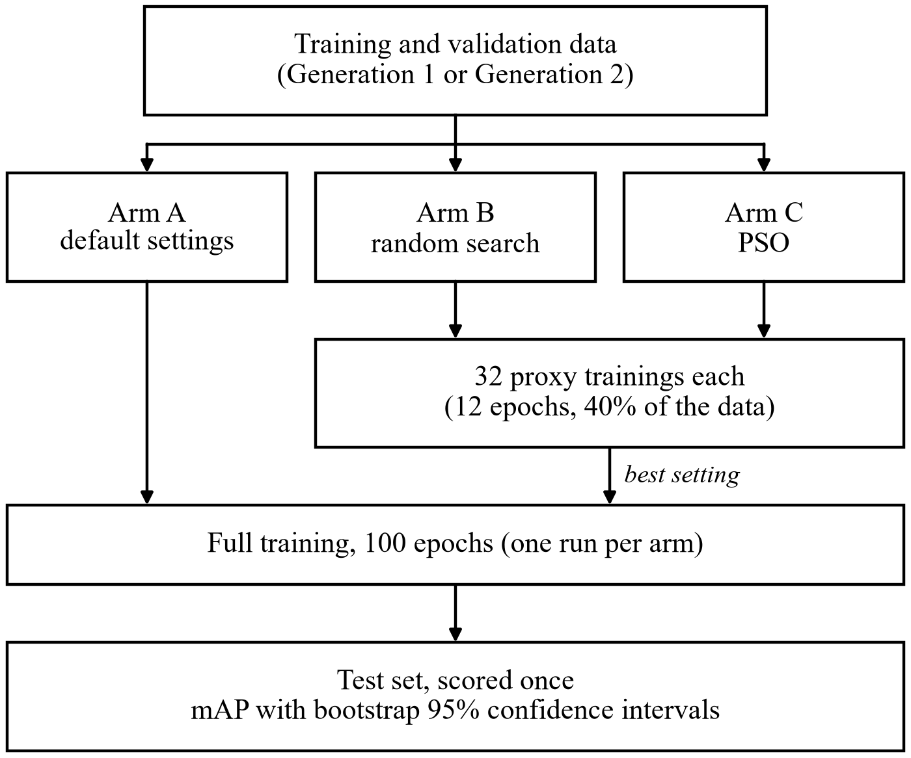

# WasteSense

WasteSense is a waste detector built on YOLOv8n. Give it a photo and it draws a box around each item, labels it (biodegradable, cardboard, glass, metal, paper, plastic or other) and says which bin it belongs in.

The project is also an experiment. We wanted to know whether Particle Swarm Optimization (PSO) can pick better training hyperparameters for the detector than random search or the Ultralytics defaults, when all of them get the same budget. We ran that comparison twice, first on clean studio photos (Generation 1) and then again after adding real-world litter photos (Generation 2).

The short answer: PSO did not beat random search either time, and the training data mattered far more than the tuning.

<p align="center">
  
</p>

This is our Soft Computing course project (Semester V, Unit V: swarm intelligence) at NSUT, New Delhi. There is a research paper in [paper/](paper/) and a project report in [report/](report/).

## Contents

- [Results](#results)
- [How it works](#how-it-works)
- [Demo app](#demo-app)
- [Repository layout](#repository-layout)
- [Setup](#setup)
- [Reproducing the experiment](#reproducing-the-experiment)
- [Limitations](#limitations)
- [References and data](#references-and-data)
- [Authors](#authors)

## Results

All numbers come from the JSON files in [results/](results/) and [results/gen2/](results/gen2/). The metric is test mAP@50, and the brackets are 95% confidence intervals from a paired bootstrap over the test images. A difference counts as significant only if its interval excludes 0.

The three arms are A (Ultralytics defaults, no search), B (best of 32 random samples) and C (PSO, 8 particles for 4 rounds). B and C each spend 32 short proxy trainings.

### Generation 1: studio photos

Trained on 7,324 studio images in 6 classes at 416 px, tested on 1,046 images.

| Arm | Test mAP@50 | Test mAP@50-95 | Precision | Recall |
|---|---|---|---|---|
| A: defaults | 0.676 [0.639, 0.722] | 0.474 [0.441, 0.518] | 0.747 | 0.581 |
| B: random search | 0.672 [0.634, 0.717] | 0.475 [0.441, 0.519] | 0.746 | 0.587 |
| C: PSO | 0.668 [0.627, 0.717] | 0.471 [0.437, 0.516] | 0.747 | 0.586 |

No pairwise difference is significant. The largest is C minus A at -0.008 [-0.021, +0.007]. The three arms are tied, and the defaults even have the highest point estimate. Full table: [results/test_comparison.md](results/test_comparison.md).

### Generation 2: studio plus real-world photos

Trained on 6,292 images (a subsample of the Gen 1 data plus TACO and HITL Recycling) in 7 classes at 640 px. Tested on four sets: all (studio and real-world together), studio, real-world, and an Indian street set (DWSD) that was never used in training.

| Arm | All (1,514) | Studio (1,046) | Real-world (468) | India (700) |
|---|---|---|---|---|
| A: defaults | 0.479 [0.453, 0.513] | 0.571 [0.529, 0.619] | 0.310 [0.278, 0.440] | 0.027 [0.024, 0.031] |
| B: random search | 0.497 [0.471, 0.531] | 0.595 [0.557, 0.639] | 0.298 [0.271, 0.407] | 0.023 [0.021, 0.027] |
| C: PSO | 0.500 [0.474, 0.534] | 0.590 [0.550, 0.635] | 0.310 [0.279, 0.415] | 0.027 [0.024, 0.031] |

Differences in test mAP@50 (bold means significant):

| Pair | All | Studio | Real-world | India |
|---|---|---|---|---|
| B - A | **+0.017** [+0.006, +0.030] | **+0.024** [+0.009, +0.038] | -0.012 [-0.118, +0.053] | **-0.003** [-0.006, -0.001] |
| C - A | **+0.020** [+0.011, +0.032] | **+0.019** [+0.005, +0.033] | +0.001 [-0.111, +0.065] | +0.000 [-0.003, +0.003] |
| C - B | +0.003 [-0.008, +0.015] | -0.005 [-0.018, +0.009] | +0.013 [-0.015, +0.036] | **+0.003** [+0.001, +0.006] |

<p align="center">
  
</p>

What this shows:

- On the all and studio sets, both searches beat the defaults by about 0.02. PSO and random search cannot be told apart.
- On real-world photos nothing is significant. The intervals are wide because this set has only one BIODEGRADABLE box, and that one image swings the average.
- On Indian photos all three models fail (0.023 to 0.027). The "significant" differences there are a few thousandths on scores near zero and mean nothing in practice.
- The OTHER class is very weak for every arm (AP@50 between 0.050 and 0.063).

Per-domain tables: [results/gen2/test_domains.md](results/gen2/test_domains.md).

### Gen 1 against Gen 2 on the same images

The two generations have different classes and image sizes, so their test scores cannot be compared directly. We scored all six models on the same studio and real-world test images, using only the six classes they share.

| Model | Real-world (468 images) | Studio (1,046 images) |
|---|---|---|
| Gen 1 A | 0.047 [0.038, 0.080] | 0.676 [0.641, 0.719] |
| Gen 1 B | 0.038 [0.031, 0.069] | 0.672 [0.636, 0.716] |
| Gen 1 C | 0.096 [0.041, 0.214] | 0.669 [0.628, 0.716] |
| Gen 2 A | 0.353 [0.315, 0.504] | 0.571 [0.529, 0.619] |
| Gen 2 B | 0.338 [0.304, 0.473] | 0.595 [0.557, 0.639] |
| Gen 2 C | 0.352 [0.315, 0.485] | 0.590 [0.550, 0.635] |

Every Gen 2 model is significantly better than every Gen 1 model on real-world photos (by 0.243 to 0.315), and every Gen 1 model is significantly better on studio photos (by 0.074 to 0.105). Adding real-world training data raised real-world accuracy four to nine times and cost some studio accuracy. Tuning did not change the real-world score in either generation.

Full tables: [real-world](results/gen2/test_g1g2_real_world_comparison.md), [studio](results/gen2/test_g1g2_studio_comparison.md).

### Where the Gen 2 models work

We also checked each of the 468 real-world test images one by one. A model gets an image "fully right" if it finds every object with the correct class and adds no false box.

| Objects in the image | Images | Fully right (A / B / C) |
|---|---|---|
| 1 | 375 | 164 / 167 / 166 |
| 2 | 47 | 2 / 1 / 4 |
| 3 or more | 46 | 0 / 0 / 0 |

So the models can handle a single item in a real scene, but not a cluttered scene with several items.

<details>
<summary>Sample detections on studio, real-world and Indian test images</summary>

<p align="center">
  
</p>
</details>

### What we take from it

In Gen 1 the defaults were already close to the best that this model and data allow, so there was nothing for a search to find. In Gen 2 a search did help a little, but random search helped as much as PSO, so the gain comes from searching at all and not from the swarm. If we had compared PSO with the defaults only, we would have given the swarm the credit.

The short proxy training ranked very different settings almost perfectly, but it could not order the top few. In Gen 1 the setting with the best proxy score ended with the lowest validation score after 100 epochs.

The data mattered most. Real-world training photos changed the real-world score far more than any tuning did, and a domain with no training data (India) fails regardless of tuning.

## How it works

<p align="center">
  
</p>

### Data

Generation 1 uses the Kaggle dataset [Garbage Detection - 6 Waste Categories](https://www.kaggle.com/datasets/viswaprakash1990/garbage-detection): 10,464 studio-style images at 416×416 with YOLO boxes. The folders that ship with it are split by class (the test folder has no glass images at all, for example), so we pooled everything and split it again 70/20/10, stratified by class. Near-duplicate images are kept in the same split so nothing leaks from train into test. The split is saved in [configs/split.csv](configs/split.csv).

Generation 2 merges four sources with [src/build_dataset.py](src/build_dataset.py), configured in [configs/gen2/sources.yaml](configs/gen2/sources.yaml):

| Source | Format | Licence | Used for | Domain |
|---|---|---|---|---|
| Gen 1 data (3,000 train, 900 val, all 1,046 test images) | YOLO | CC BY 4.0 | train, val, test | studio |
| TACO (1,500 images) | COCO | CC BY 4.0 | train, val, test | real-world |
| HITL Recycling (3,201 images) | Supervisely JSON | CC0 | train, val, test | real-world |
| DWSD, Kolkata streets (700 of 784 images) | semantic masks | CC BY 4.0 | test only | India |

Gen 2 adds a seventh class, OTHER, for litter that is none of the six materials (cigarette butts, textiles, mixed bags and so on).

DWSD needs a warning. It ships masks and not boxes, so we turn each connected region of one class into a box. Touching items of the same class therefore end up in one big box, and a correct detection of a single item gets counted as a miss. The class table published with DWSD also does not match the masks, so we had to work out the mapping by looking at the images. The India scores partly measure this labeling mismatch.

### Search space

Both searches tune the same six training hyperparameters ([src/search_space.py](src/search_space.py)):

| Hyperparameter | Range | Scale | Default (Arm A) |
|---|---|---|---|
| `lr0` (initial learning rate) | 1e-4 to 1e-2 | log10 | 0.01 |
| `lrf` (final LR as a fraction of `lr0`) | 0.01 to 0.2 | linear | 0.01 |
| `momentum` | 0.60 to 0.98 | linear | 0.937 |
| `weight_decay` | 1e-5 to 1e-3 | log10 | 0.0005 |
| `mosaic` (probability) | 0 to 1 | linear | 1.0 |
| `scale` (rescaling gain) | 0.2 to 0.8 | linear | 0.5 |

The settings each search ended up with:

| | Gen 1 B | Gen 1 C | Gen 2 B | Gen 2 C |
|---|---|---|---|---|
| `lr0` | 0.00703 | 0.00315 | 0.00445 | 0.00251 |
| `lrf` | 0.0625 | 0.0751 | 0.0506 | 0.0693 |
| `momentum` | 0.912 | 0.949 | 0.882 | 0.916 |
| `weight_decay` | 0.000602 | 0.000260 | 0.000182 | 0.000407 |
| `mosaic` | 0.513 | 0.272 | 0.927 | 0.387 |
| `scale` | 0.347 | 0.471 | 0.339 | 0.373 |
| Best proxy mAP@50 | 0.4995 | 0.4953 | 0.3340 | 0.3290 |

All four picked a learning rate below the default.

### PSO

[src/pso.py](src/pso.py) is our own implementation, a standard global-best PSO with an inertia weight, written in NumPy. Each particle is one hyperparameter vector. It remembers its own best position (pbest) and the swarm remembers the best position overall (gbest):

```
v = w*v + c1*r1*(pbest - x) + c2*r2*(gbest - x)
x = x + v
```

We use 8 particles for 4 rounds (32 evaluations), c1 = c2 = 1.5, and an inertia weight that falls from 0.9 to 0.4. Velocities are limited to 20% of each range and positions are clipped to the bounds. The seed is 42 for PSO and 123 for random search.

The optimizer has an ask/tell interface and never trains anything itself, so the same class runs on test functions and on the real search. Before using it we checked it on the 6-D Sphere and Rastrigin functions ([src/pso_benchmark.py](src/pso_benchmark.py)).

<details>
<summary>The Gen 1 swarm and the random samples in the lr0/momentum plane</summary>

<p align="center">
  
</p>
</details>

### Proxy training

A full training takes one to two hours on a Kaggle T4, so 64 of them per generation was out of the question. Each candidate is scored with a short proxy instead: 12 epochs on a stratified 40% of the training split, and the fitness is the validation mAP@50.

A proxy is only useful if it ranks settings the way a longer training would, so we tested that before the Gen 1 searches. Eight settings (seven from a Latin hypercube plus the defaults) were each trained with the proxy and with a 40-epoch run. We had decided in advance to accept the proxy if the Spearman correlation was at least 0.6. It came out at 0.976 ([results/proxy_check.json](results/proxy_check.json)). We did not repeat the check for Gen 2.

### Full training and evaluation

The setting chosen by each arm is trained once: 100 epochs, SGD, batch 16, seed 42, from the COCO-pretrained `yolov8n.pt`. The only thing that differs between arms is the six searched values. Two Ultralytics defaults had to be avoided. `optimizer=auto` ignores `lr0` and `momentum`, which would make the search pointless, and `fraction` takes the first N sorted images and not a random sample.

Each test split was scored once, at the very end, by [src/evaluate.py](src/evaluate.py). It uses the Ultralytics validator and then a paired bootstrap: the test images are resampled 1,000 times, every model is scored on the same resample, and the 2.5th and 97.5th percentiles give the interval for each model and each difference.

The longer story, with every decision and everything that went wrong, is in [docs/EVOLUTION.md](docs/EVOLUTION.md).

## Demo app

```bash
.venv/Scripts/python -m streamlit run app/app.py
```

The app runs from a fresh clone because all six trained models are in the repository (Gen 1 in [app/models/](app/models/), Gen 2 in `app/models/gen2/`). No dataset or GPU is needed.

In the sidebar you choose the generation (Gen 2 is the default), the arm (A, B or C) and the confidence and NMS thresholds. You can upload photos, take one with the camera, or pick a random studio test image if the Gen 1 dataset is on your machine. For each photo the app shows the boxes, a table of items with their bin and a disposal tip, and the number of items per bin.

The bins follow India's Solid Waste Management Rules, 2016:

| Item | Bin |
|---|---|
| BIODEGRADABLE | Green (wet waste, compost) |
| PAPER, CARDBOARD, PLASTIC, METAL, GLASS | Blue (dry recyclables) |
| OTHER (Gen 2 only) | Reject (not recyclable, or check local rules) |

Keep the results above in mind when trying it. It does well on a single clear item and poorly on a pile.

## Repository layout

```
app/            Streamlit demo (app.py, helpers.py) and the six trained models
configs/        Gen 1 split file; Gen 2 sources, arms and comparison configs
docs/           EVOLUTION.md (full history), FUTURE_WORK.md, RELATED_WORK.md, images
notebooks/      Kaggle notebooks: phase*.ipynb for Gen 1, gen2/ for Gen 2
paper/          research paper (LaTeX), figures and the scripts that draw them
report/         project report
results/        every result file: Gen 1 at the top level, Gen 2 in gen2/
src/            dataset checks and builder, PSO, search, training, evaluation
tests/          unit tests
```

The main scripts in `src/`:

| Script | What it does |
|---|---|
| `verify_dataset.py` | Gen 1 dataset checks and the re-split |
| `build_dataset.py` | Gen 2 dataset builder (YOLO, COCO, Supervisely and mask sources) |
| `search_space.py`, `pso.py` | the search space and the PSO |
| `search.py` | runs one search arm (PSO or random); can resume |
| `proxy_check.py` | the proxy check |
| `train_final.py` | one full 100-epoch training; `--resume` continues a stopped run |
| `evaluate.py` | test evaluation with the paired bootstrap |
| `compare_generations.py` | the Gen 1 against Gen 2 comparison on shared classes |
| `watchdog_run.py` | restarts a Kaggle run that has frozen |

## Setup

```bash
git clone https://github.com/Shreyansh303/WasteSense.git
```

```bash
cd WasteSense
```

```bash
python -m venv .venv
```

```bash
.venv/Scripts/python -m pip install -r requirements.txt
```

On Linux or macOS use `.venv/bin/python`. Ultralytics is pinned to 8.4.169 so that local and Kaggle runs train the same way.

To run the tests:

```bash
.venv/Scripts/python -m unittest discover -s tests -v
```

One test runs a short CPU training. Set `SWARMSORT_SKIP_SLOW=1` to skip it (the variable still has the project's old name).

## Reproducing the experiment

The GPU work was done in Kaggle notebooks on a Tesla T4, and everything else on a laptop. For every notebook: turn Internet on, attach the datasets it needs, and start it with Save Version, then Save & Run All, so it keeps running after you close the browser. Each notebook clones this repository, so push your commits first.

### Generation 1

1. Download the dataset from Kaggle into the project folder and check it:

   ```bash
   .venv/Scripts/python src/verify_dataset.py --root "GARBAGE CLASSIFICATION"
   ```

   This reuses `configs/split.csv` and writes `configs/data.yaml` and `results/dataset_report.json`. Always reuse the committed split file. Regenerating it can give a different split, because the duplicate detection depends on the Pillow version.

2. Train Arm A and run the proxy check on Kaggle with `phase2a_baseline.ipynb` (about 1 hour) and `phase2b_proxy_check.ipynb` (about 3 hours).

3. Check the PSO locally:

   ```bash
   .venv/Scripts/python src/pso_benchmark.py
   ```

4. Run the two searches on Kaggle with `phase4a_pso_search.ipynb` and `phase4b_random_search.ipynb` (about 2 hours each, and they can run at the same time). If a session dies, attach its output to a new run and the search continues from its log.

5. Train the two winners with `phase5a_train_arm_b.ipynb` and `phase5b_train_arm_c.ipynb`, download the weights to `results/runs/<arm>/weights/best.pt`, and evaluate locally:

   ```bash
   .venv/Scripts/python src/evaluate.py
   ```

   The test split is meant to be scored once. For a trial run use `--split val` with a scratch `--out-dir`.

### Generation 2

Gen 2 runs entirely on Kaggle, in eight notebooks in [notebooks/gen2/](notebooks/gen2/):

| Order | Notebook | What it does |
|---|---|---|
| 1 | `g2_0_build_dataset` | builds the merged 7-class dataset (CPU) |
| 2 | `g2_1_arm_a`, `g2_2_search_pso`, `g2_3_search_random` | Arm A training and the two searches (can run in parallel) |
| 3 | `g2_4_arm_b`, `g2_5_arm_c` | full training of the two winners |
| 4 | `g2_6_evaluate` | scores the three arms once on every test set |
| 5 | `g2_7_gen1_vs_gen2` | scores all six models on the same images |

The inputs, the files to download and what to do when a run freezes are described in [notebooks/gen2/README.md](notebooks/gen2/README.md). DWSD is not on Kaggle. Download it from Mendeley and upload it as a private dataset, otherwise there is no India test set.

The whole Gen 1 experiment took about 12 GPU hours and Gen 2 about 10, not counting roughly 24 hours lost when two Gen 2 sessions froze.

## Limitations

- Each arm was trained once and each search was run once, so the confidence intervals cover the choice of test images but not training noise. Another seed could change the small differences between arms.
- The proxy was checked for Gen 1 only, with eight settings and a 40-epoch reference.
- The real-world test set is small (468 images, one BIODEGRADABLE box), so it cannot show small gains.
- The India result is confounded by how we had to derive boxes and classes from the DWSD masks.
- Gen 2 lost 0.074 to 0.105 mAP@50 on studio photos compared with Gen 1. It trained on fewer studio images, at a different image size and with one more class, and we cannot say which of these caused the drop.
- Only six hyperparameters were searched, with 32 evaluations per search.

What we would do next is in [docs/FUTURE_WORK.md](docs/FUTURE_WORK.md). The top two items are Indian training data with one box per item and an ensemble of the three models.

## References and data

1. S. Majchrowska et al., "Deep learning-based waste detection in natural and urban environments," *Waste Management*, vol. 138, pp. 274-284, 2022. This was our base paper.
2. J. Kennedy and R. Eberhart, "Particle swarm optimization," *Proc. IEEE ICNN*, 1995.
3. Y. Shi and R. Eberhart, "A modified particle swarm optimizer," *Proc. IEEE Int. Conf. Evolutionary Computation*, 1998.
4. J. Bergstra and Y. Bengio, "Random search for hyper-parameter optimization," *JMLR*, vol. 13, pp. 281-305, 2012.
5. G. Jocher, A. Chaurasia and J. Qiu, "Ultralytics YOLOv8," 2023. https://github.com/ultralytics/ultralytics
6. B. Efron and R. J. Tibshirani, *An Introduction to the Bootstrap*, Chapman & Hall, 1993.
7. Ministry of Environment, Forest and Climate Change, Government of India, "Solid Waste Management Rules, 2016."
8. P. F. Proença and P. Simões, "TACO: Trash Annotations in Context for litter detection," arXiv:2003.06975, 2020.
9. Ali et al., "Dense Waste Segmentation Dataset (DWSD)," *Data in Brief*, 2025.

The full reference list is in [paper/references.bib](paper/references.bib), and [docs/RELATED_WORK.md](docs/RELATED_WORK.md) has notes on the related papers.

Datasets:

- [Garbage Detection - 6 Waste Categories](https://www.kaggle.com/datasets/viswaprakash1990/garbage-detection) by viswaprakash1990, CC BY 4.0
- [TACO](http://tacodataset.org/), CC BY 4.0 (we used the Kaggle copy `kneroma/tacotrashdataset`)
- [Recycling dataset](https://www.kaggle.com/datasets/humansintheloop/recycling-dataset) by Humans in the Loop, CC0
- [DWSD](https://data.mendeley.com/datasets/gr99ny6b8p) on Mendeley Data, CC BY 4.0, used only as the India test set

The detector, training and validation code are from [Ultralytics](https://github.com/ultralytics/ultralytics), the demo uses Streamlit, and the GPU time was Kaggle's free tier.

## Authors

Shreyansh Jain ([@Shreyansh303](https://github.com/Shreyansh303)), Dhruv Sihag, Navya Sinha and Toshaan Kharbudon

Department of Computer Science and Engineering, Netaji Subhas University of Technology (NSUT), New Delhi
